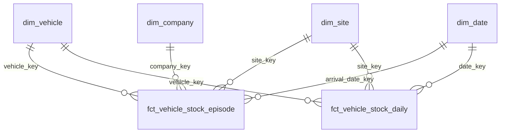

# Datamodellering och integrationslager

## Om dokumentet

Dokumentet beskriver hur data modelleras i målarkitekturen ([`malarkitektur.md`](malarkitektur.md)): vilka lager som finns, hur flera källsystem blir gemensamma entiteter, hur nycklar och historik hanteras och vilka tester som gäller. Det är ett förslag. Migreringen mot modellen beskrivs i [`migreringsplan.md`](migreringsplan.md), och schemastrukturen i [`datatyper-och-scheman.md`](datatyper-och-scheman.md).

Modelleringen följer Kimballs metod: dimensionella modeller med konformerade dimensioner. Det som skiljer är ett integrationslager mellan staging och marts, där entiteter från flera källsystem förenas innan de presenteras som dimensioner.

Källsystem benämns Källsystem A, B och C i exemplen.

## 1. Lager

```text
raw  →  staging  →  integration  →  marts
                       ↑
                  ref och xref
```

| Lager | Schema i `{miljö}_core` | Prefix | Innehåll | Regler | Läses av |
| --- | --- | --- | --- | --- | --- |
| Raw | `{miljö}_raw` (egen katalog) | Källans namn | Källdata oförändrad, med teknisk spårbarhet | Ingen logik. Ändras aldrig | dbt (data build tool) |
| Staging | `staging` | `stg_` | Typning, namnstandard, en modell per källtabell | Ingen affärslogik. Ingen join mellan källor | Integration och marts |
| Integration | `integration` | `ent_` | En rad per verklig entitet, oberoende av källsystem | Identitetsmatchning, nycklar, survivorship. Inga mått | Marts |
| Referens | `ref` | `ref_` | Kodlistor, mappningar och hierarkier som verksamheten äger | Kommer från referensdataflödet | Integration och marts |
| Korsreferens | `xref` | `xref_` | Koppling mellan källsystemens id och entitetens nyckel | Skrivs bara av dbt (data build tool). Nycklar skapas en gång | Integration och marts |
| Mellansteg | `intermediate` | `int_` | Återanvänd logik som inte är en entitet | Ingen läsning från Power BI (Business intelligence) | Marts |
| Marts | `marts` | `dim_`, `fct_` | Dimensioner och fakta för rapportering | Enda lagret som Power BI (Business intelligence) läser | Power BI (Business intelligence) och analytiker |

Staging och integration är åtskilda eftersom de har olika ansvar. Staging gör källan läsbar, och integration avgör vad som är samma sak i flera källor. En modell som gör båda sakerna går inte att testa åt ett håll i taget.

### När integrationslagret kan hoppas över

En entitet som bara finns i ett källsystem och bara har en konsument går direkt från staging till `dim_`. Integrationslagret behövs när minst en av följande gäller:

- entiteten finns i två eller fler källsystem,
- entiteten används av mer än ett område eller en mart,
- identiteten måste bestämmas av regler och inte av en enda nyckel.

## 2. Entiteter i omfång

Entiteterna byggs vid första behov. Kund byggs sist, när kunddata från CRM (Customer relationship management)-systemet finns i plattformen och en granskning mot GDPR (General data protection regulation) är gjord.

| Entitet | Nyckel för matchning | Områden som behöver den | Byggs i fas |
| --- | --- | --- | --- |
| Fordon | VIN (Vehicle identification number, chassinummer), annars registreringsnummer och datum | Lagerbilar, försäljning, eftermarknad | 2 |
| Organisation: bolag, anläggning, kostnadsställe | Källsystemens koder, kopplade via mappning som ekonomi äger | Alla områden, särskilt finans | 2 |
| Artikel och del | Tillverkarens artikelnummer och varumärke | Eftermarknad, försäljning av tillbehör | 3 |
| Kund | Organisationsnummer och personnummer | Kund tvärs över bolagen | Senare |

### Fordon

**Nivå:** en rad per fysiskt fordon.

**Identitet:** VIN (Vehicle identification number) har 17 tecken och innehåller aldrig bokstäverna I, O och Q. Det normaliseras (versaler, utan mellanslag) och valideras före matchning. Registreringsnummer är inte en stabil identitet, eftersom det byts vid omregistrering och kan återanvändas. Det lagras därför som ett attribut med giltighetsperiod i en egen tabell, `ent_vehicle_registration`.

**Matchning, i prioritetsordning:**

1. Exakt VIN (Vehicle identification number).
2. Registreringsnummer tillsammans med ett datum som ligger inom registreringens giltighetsperiod, för poster som saknar VIN (Vehicle identification number).
3. Poster som ingen regel matchar behåller en egen entitet och markeras `match_rule = 'none'`.

**Historik:** beskrivande attribut (modell, årsmodell, drivlina) skrivs över (SCD (Slowly changing dimension) typ 1). Det som ändras över tid och behövs i rapporter, som status och ägare, lagras som händelser i egna tabeller.

### Organisation

**Nivå:** en entitet per bolag, anläggning och kostnadsställe, med hierarki som gäller över tid.

**Identitet:** källsystemens koder mappas till entiteten med `xref_cost_center`, `xref_site` och `xref_company`. Mappningarna underhålls av ekonomi och går genom referensdataflödet, eftersom ingen gemensam nyckel finns att matcha på.

**Historik:** SCD (Slowly changing dimension) typ 2. Organisationer slås ihop, delas och byter överordnad enhet, och rapporter för tidigare perioder ska visa organisationen som den var då.

### Artikel och del

**Nivå:** en rad per artikel och varumärke.

**Identitet:** tillverkarens artikelnummer är den gemensamma nyckeln. Artiklar där det saknas kopplas för hand via referensdataflödet.

**Särskilt:** artiklar ersätts av nya artiklar. Ersättningar lagras som en bro, `ent_part_supersession`, så att försäljning av en gammal och en ny artikel kan summeras.

## 3. Nycklar

| Typ | Namn | Hur den skapas | Varför |
| --- | --- | --- | --- |
| Källnyckel | `source_{entitet}_id` | Kopieras från källan | Spårbarhet mot källsystemet |
| Källsystem | `source_system` | Fast kod i en referenstabell | Samma id kan finnas i flera system |
| Entitetsnyckel | `{entitet}_key` | Se nedan | Samma nyckel för samma verkliga sak, oavsett källa |

**Entiteter med stabil affärskod** (organisation, artikel) får nyckeln som en hash av affärskoden med `dbt_utils.generate_surrogate_key`. Samma kod ger samma nyckel i utveckling, test och produktion.

**Entiteter som matchas** (fordon, senare kund) får nyckeln när entiteten först identifieras, som en hash av den första källpostens källsystem och id. Nyckeln sparas i `xref` och ändras aldrig. En deterministisk hash som räknas om varje körning skulle byta nyckel när matchningen förbättras, till exempel när ett VIN (Vehicle identification number) fylls i på en post som tidigare bara hade registreringsnummer. Rapporter och fakta som pekar på den gamla nyckeln skulle då tappa sin koppling.

**Sammanslagning:** när två entiteter visar sig vara samma behålls den äldre nyckeln. Den andra sparas i `xref_merge` med `merged_into`, och fakta följer den nya kopplingen vid nästa körning.

**Okänd:** varje dimension har en rad med en fast nyckel för "okänd". Fakta vars nyckel saknas pekar dit, och ett test varnar när andelen överstiger en gräns som dataägaren sätter.

## 4. Identitetsmatchning

Matchningen går i fem steg som alla är dbt (data build tool)-modeller med tester.

| Steg | Vad som görs | Skrivs till |
| --- | --- | --- |
| 1. Normalisera | Versaler, trimning, borttagning av tecken som inte ingår i nyckeln | `staging` |
| 2. Matcha | Regler i prioritetsordning, första träff gäller | `xref_{entitet}` med `match_rule` |
| 3. Tilldela nyckel | Ny entitet får en nyckel, matchad post får befintlig | `xref_{entitet}` |
| 4. Survivorship | Välj värde per attribut enligt prioritetslista | `ent_{entitet}` |
| 5. Mät | Andel matchade poster per källsystem och regel | Testresultat och rapport |

**Matchningsmetod:** den börjar deterministisk. Poster matchas på exakta nycklar, och andelen som inte matchar mäts per källsystem. Först när mätningen visar att för många poster blir dubbletter avgörs om sannolikhetsmatchning behövs. Sannolikhetsmatchning kräver ett verktyg, en granskningsprocess för osäkra par och en ägare, och bör inte införas innan behovet är mätt.

**Manuella kopplingar:** poster som reglerna inte matchar men som verksamheten vet hör ihop läggs i en liten fil som går genom referensdataflödet (`ref_manual_match`). Matchningen läser den före reglerna.

**Survivorship:** när flera källor har ett värde för samma attribut väljs värdet efter en prioritetslista per attribut och källsystem. Listan är referensdata (`ref_attribute_priority`) som dataägaren äger, så att prioriteringen går att ändra utan kodändring. Nyare värde vinner endast när källorna är likvärdiga.

## 5. Historik

| Typ | När den används | Exempel | Hur |
| --- | --- | --- | --- |
| SCD (Slowly changing dimension) typ 1 (skriv över) | Beskrivande attribut där historiken inte behövs i rapporter | Fordonets modellbeteckning | Senaste värdet |
| SCD (Slowly changing dimension) typ 2 (ny rad per version) | Attribut som påverkar var historiska fakta hamnar | Organisationens hierarki | `valid_from`, `valid_to`, `is_current`. Dbt (data build tool) snapshot eller en egen inkrementell modell |
| Händelsetabell | Förändringar som själva är analysobjekt | Fordonets status, registreringar | Fakta, en rad per händelse |

Historik som källsystemen inte har kan inte återskapas. Historiken börjar den dag modellen börjar köras, och äldre perioder får det värde källan har i dag. Det ska framgå av dokumentationen för varje dimension.

I SCD (Slowly changing dimension) typ 2-dimensioner slår fakta upp radens nyckel vid tidpunkten för händelsen, med `valid_from <= händelsedatum < valid_to`. Verksamheten anger bara `valid_from` i referensdata, och dbt (data build tool) räknar ut `valid_to` som starten på nästa version. Det utesluter överlappande perioder.

## 6. Faktatabeller

Varje faktatabell har en deklarerad nivå (vad en rad är) i modellens dokumentation.

| Typ | När | Exempel |
| --- | --- | --- |
| Transaktion | En händelse, en rad, ändras inte | `fct_sales`, `fct_invoice_line`, `fct_call` |
| Periodisk ögonblicksbild | Tillstånd vid fast intervall | `fct_vehicle_stock_daily`: ett fordon i lager per dag, för kapitalbindning |
| Ackumulerande ögonblicksbild | En process med flera datum, en rad per förekomst som uppdateras | `fct_vehicle_stock_episode`: ankomst, klarmarkering, bokning, försäljning och leverans, med tid mellan stegen |

Ståtid mäts med den ackumulerande ögonblicksbilden. Kapitalbindning och ränta räknas på den periodiska, eftersom de behöver ett värde per dag.

## 7. Exempel: lagerbilar



Flöde från källa till rapport:

1. `stg_source_a__stock` och `stg_source_b__vehicle` hämtar och typar källdata.
2. `xref_vehicle` matchar posterna på VIN (Vehicle identification number), annars registreringsnummer och datum, och tilldelar `vehicle_key`.
3. `ent_vehicle` väljer attribut per prioritetslista.
4. `dim_vehicle` presenterar entiteten för rapporter. Anläggning och bolag kommer från `ent_site` och `ent_company` via `xref`.
5. `fct_vehicle_stock_episode` och `fct_vehicle_stock_daily` bygger på staging, med nycklar från `xref`.
6. Den semantiska modellen i Power BI (Business intelligence) definierar nyckeltalen ståtid, räntekostnad och andel bilar över 90 dagar.

## 8. Dbt-struktur

```text
models/
  staging/{källa}/        stg_*       vy eller tabell
  ref/                    ref_*       tabell
  xref/                   xref_*      inkrementell, bara tillägg
  integration/            ent_*       tabell
  intermediate/           int_*       vy eller tabell
  marts/{område}/         dim_*, fct_* tabell eller inkrementell
```

- Staging kan vara vyer. Marts materialiseras som fysiska tabeller, eftersom bara fysiska tabeller speglas till Fabric.
- Allt i `xref` är inkrementellt och tillägg. Rader tas aldrig bort, och nycklar ändras aldrig.
- Samma kod körs i alla miljöer. Bara `target` och katalog skiljer.
- Varje modell har en beskrivning, deklarerad nivå och ägare i sin modellfil.

## 9. Tester per lager

| Lager | Tester |
| --- | --- |
| Staging | Källnyckel är unik och inte null. Färskhet mot källsystemet. Radantal mot raw |
| Xref | Varje källpost har exakt en entitetsnyckel. Inga överlappande giltighetsperioder. Inga ändrade nycklar jämfört med föregående körning |
| Integration | `{entitet}_key` är unik. Varje entitet har minst en källpost. Matchningsgrad per källsystem över en gräns |
| Ref | Unik nyckel med period, utan överlapp. Relationer mot entiteterna. Täckning mot transaktionsdata, som varnar |
| Marts | Varje fakta-nyckel finns i sin dimension. Andel "okänd" under en gräns. Summor mot facit under parallellkörning |

Teststrukturen för referensdata finns i [`datatyper-och-scheman.md`](datatyper-och-scheman.md).

## 10. Hårdkodad logik och determinism

Två krav gäller för all kod i plattformen:

1. Data som styr vilka rader som tas med, hur värden översätts eller vilka poster som rättas ligger i tabeller med ägare, orsak och giltighetsperiod. Det ligger inte i SQL (Structured query language).
2. Samma indata ger samma utdata, vid varje körning och i alla miljöer.

### Lista eller regel

En sats får stå i koden när den uttrycker en regel över attribut eller intervall. En sats som räknar upp värden, id eller namn är data och flyttas ut.

| Mönster | Exempel | Bedömning | Åtgärd |
| --- | --- | --- | --- |
| Regel över attribut | `case when amount < 0 then 'credit' else 'debit' end` | Logik | Står kvar, med dokumenterad regel och test |
| Teknisk hantering | `cast`, `trim`, `coalesce` för känd nullhantering | Logik | Står kvar i staging |
| Uppräkning av värden | `where status not in ('A', 'B', 'C')` | Data | Referenstabell och anti-join |
| Uppräkning av poster | `where customer_id not in (1001, 1002, 1003)` | Data | Exkluderingslista med orsak och ägare |
| Värdeöversättning | `case when code = 'X' then 'New' when code = 'Y' then 'Used' end` | Data | `ref_`-tabell och join |
| Enstaka rättelse | `case when id = 4711 then 'cost center X' else cost_center end` | Data | Manuell rättelse i referensdata, med orsak och giltighet |
| Konstant med affärsbetydelse | Tröskel på 90 dagar, skattesats, startår i ett filter | Data | Referensdata med giltighetsperiod |
| Teknisk konstant | Första datum som data ska läsas från | Konfiguration | `var` i dbt (data build tool) |

### Var listorna ska ligga

| | dbt (data build tool) seed | Referensdataflödet | `var` i dbt (data build tool) |
| --- | --- | --- | --- |
| Vem ändrar | Utvecklare | Verksamheten | Utvecklare |
| Ändringsväg | Pull request och automatiska tester | Validering, `dbt test` i test och godkännande av dataägaren | Pull request |
| Versionshistorik | Git | Kontrolltabell med version och godkännande | Git |
| Storlek | Upp till några hundra rader | Hundratals filer, valfri storlek | Enstaka värden |
| Innehåll | Tekniska och opersonliga listor | Verksamhetens listor och allt som pekar ut personer, kunder, fordon eller anställda | Tekniska konstanter |

**Bedömning:** standardvalet är referensdataflödet. En seed används bara när alla fyra villkor gäller:

- listan ägs av utvecklarna,
- den innehåller inga personuppgifter och inga id som pekar ut kunder, fordon eller anställda,
- den ändras sällan,
- ingen utanför teamet behöver granska ändringarna.

En seed ligger i Git, och en rad som en gång checkats in finns kvar i historiken även när den tas bort. Repot kan dessutom vara publikt. Listor över kund- eller fordonsnummer hör därför hemma i referensdataflödet. Dokumentationen för dbt (data build tool) beskriver seeds som lämpade för statisk data som sällan ändras, med en lista över testkonton att utesluta som exempel, och avråder från seeds för data som innehåller personuppgifter.

### Filter som anti-join, med karantän

Före:

```sql
select *
from {{ ref('stg_source_a__orders') }}
where customer_id not in (1001, 1002, 1003)
  and order_type <> 'TEST'
```

Efter:

```sql
select o.*
from {{ ref('stg_source_a__orders') }} as o
left join {{ ref('ref_excluded_customer') }} as x
  on  o.customer_id = x.customer_id
  and o.order_date >= x.valid_from
  and o.order_date <  x.valid_to
where x.customer_id is null
```

Raderna som filtreras bort sparas i en karantänmodell med orsaken, `stg_source_a__orders_excluded`, så att det alltid går att se vad som uteslutits och varför. Ett gemensamt makro (`exclude_by_list`) ger alla modeller samma mönster.

Listan har tre fält utöver nyckeln: `reason`, `owner` och `valid_from`. Giltighetens slut räknas ut av dbt (data build tool), på samma sätt som för övrig referensdata.

Tester som hör till mönstret:

- Antalet uteslutna rader per orsak jämförs mot föregående körning, och en kraftig ändring varnar.
- Poster i listan som aldrig matchar någon rad varnar, eftersom de är kvarlevor.
- Raden i karantänen och raden i huvudmodellen summerar till radantalet i staging.

### Översättningar och rättelser

En `case`-sats med en avslutande `else` som tilldelar ett affärsvärde klassificerar varje nytt värde fel, utan att något syns. Nya koder i källsystemet hamnar då i fel kategori och tas först upp när en siffra inte stämmer.

Översättningar görs i stället med en join mot en `ref_`-tabell. Värden som saknar rad får `Okänd`, och ett test varnar med en lista över de värden som saknar mappning. Dataägaren får listan och lägger till raden i referensdataflödet.

Enstaka rättelser ("om kund 4711 då kostnadsställe X") läggs i referensdata med orsak och giltighetsperiod. Då går det att se när en rättelse kom till, varför och vem som beslutade, och att ta bort den när källan har rättats.

### Determinism

En modell är deterministisk när samma indata ger samma utdata oavsett när körningen sker, i vilken ordning raderna läses och hur många noder som körs. En körning som upprepas ger då samma resultat. Följande mönster bryter mot det.

| Mönster | Varför det ger olika resultat | Gör så här |
| --- | --- | --- |
| `current_date()`, `current_timestamp()` eller `getdate()` i affärslogik | Resultatet beror på när körningen sker, och en omkörning av en gammal dag ger ett annat svar | Skicka in datumet som variabel (`var('data_date')`) eller läs det ur datan. Tekniska tidsstämplar som `_loaded_at` är undantaget |
| `row_number()` eller `rank()` med en `order by` som inte är unik | Vid lika värden väljs en godtycklig rad | Lägg till en nyckel som bryter oavgjort, till exempel källnyckel och `_loaded_at` |
| `limit 1`, `top 1` eller `first()` utan fullständig sortering | Samma problem | Samma åtgärd |
| `distinct` för att dölja dubbletter | Vilken av två nästan lika rader som behålls är slumpmässigt, och dubbletterna visar att nivån är fel | Hitta orsaken, deklarera nivån och testa att nyckeln är unik |
| `rand()`, `uuid()` eller `monotonically_increasing_id()` som nyckel | Nyckeln byts vid varje körning | Hash av affärsnyckel eller sparad nyckel (avsnitt 3) |
| Inkrementell laddning som läser från senaste tidsstämpel i målet | Rader som kommer sent tappas, och en omkörning ger ett annat resultat | Överlappande fönster och `merge` på en unik nyckel |
| Belopp som `double` | Summeringsordningen varierar mellan körningar, och avvikelserna syns i decimalerna | `decimal` med fast skala för alla belopp |
| `select *` i staging och integration | En ny kolumn i källan ändrar modellen utan att någon har beslutat det | Explicit kolumnlista |
| Beroende av vilken tabell som laddats först | Resultatet beror på körningens ordning | Explicit `ref()` och färskhetskrav i `sources` |

Ett test kör varje modell två gånger mot samma indata i CI (Continuous integration) och jämför radantal och kontrollsumma. Skiljer de sig åt är modellen inte deterministisk.

### Kontroll i pull request

En automatisk kontroll i CI (Continuous integration) stoppar en pull request som innehåller något av följande i en modell:

- `in (...)` eller `not in (...)` med fem eller fler literala värden,
- `case` med fyra eller fler grenar som jämför mot literala värden,
- `current_date`, `current_timestamp`, `getdate`, `rand` eller `uuid` utanför staging,
- `distinct` eller `limit 1` utan en kommentar `-- allow: <orsak>`.

Ett undantag kräver en kommentar med orsak, och granskaren avgör om den håller. Kontrollen börjar som en enkel textsökning och kan senare bli en regel i en linter för SQL (Structured query language).

## 11. Regler för modelleringen

**Gör**

- Deklarera nivån för varje tabell i dess modellfil, och ha en modell per nivå.
- Lägg affärsregler i modeller med tester och en ägare i regelkatalogen.
- Spara källsystem och källnyckel på varje rad som kommer från ett källsystem.
- Mät matchningsgrad och andel okända nycklar vid varje körning.
- Lägg manuella rättelser i referensdata, så att de syns och kan granskas.

**Gör inte**

- Lägg inte affärslogik i staging eller i rapportlagret.
- Joina inte mellan källor i staging.
- Hårdkoda inte listor över värden, id eller rättelser i SQL (Structured query language). Se avsnitt 10.
- Skriv inte en `else` som tilldelar ett affärsvärde. Värden som saknar mappning får `Okänd` och ett varnande test.
- Använd inte `current_date()`, `distinct` eller `limit 1` för att få en modell att fungera.
- Skapa inte många-till-många-relationer utan en bro.
- Räkna inte om nycklar för matchade entiteter varje körning.
- Låt inte Power BI (Business intelligence) läsa från `staging`, `integration`, `ref` eller `xref`.

## 12. Öppna punkter

- **Prioritet per attribut.** Dataägarna behöver bestämma vilket källsystem som gäller för varje attribut när källorna skiljer sig, till exempel modellbeteckning eller färg. Utan beslut väljs senast uppdaterade värde, vilket ger ett resultat som växlar.
- **VIN (Vehicle identification number)-kvalitet.** Andelen poster utan giltigt VIN (Vehicle identification number) är oklar före inventeringen i migreringens fas 0 och avgör hur viktig registreringsnummer-matchningen blir.
- **Detaljnivå för organisation.** Ekonomi behöver bestämma om kostnadsställe är den lägsta nivån i `ent_cost_center`, eller om källor med finare uppdelning ska summeras uppåt.
- **Kund.** Matchning på personnummer och organisationsnummer, vilka kunddata som får läsas av AI-verktyg och vem som äger kunddata ska avgöras innan kund byggs.
- **Datum och tid.** En gemensam regel behövs för tidszon och för vad som är dagens gräns i snapshots.

## Ordlista

| Begrepp | Förklaring |
| --- | --- |
| Anti-join | En join som behåller raderna som saknar träff i en annan tabell. Används för att filtrera bort rader enligt en lista. |
| Bro | Tabell som kopplar två entiteter där flera poster på ena sidan hör till flera på andra. |
| Determinism | Egenskapen att samma indata alltid ger samma utdata, oavsett när och hur körningen sker. |
| Dimension | Tabell som beskriver något man analyserar efter, till exempel fordon, anläggning eller datum. |
| Entitet | En verklig sak som verksamheten håller reda på, till exempel ett fordon eller en anläggning. |
| Fakta | Tabell med händelser och mått, till exempel försäljning eller lagerbilar per dag. |
| Integrationslager | Lagret där poster från flera källsystem förenas till en rad per verklig entitet. |
| Karantän | Tabell som sparar rader som filtrerats bort, med orsak, så att det går att se vad som uteslutits. |
| Konformerad dimension | En dimension som är densamma för alla områden som använder den. |
| Matchning | Att avgöra att två poster i olika system beskriver samma sak. |
| Nivå (grain) | Vad en rad i en tabell står för, till exempel ett fordon eller ett fordon per dag. |
| SCD (Slowly changing dimension) | Sätt att hantera attribut som ändras över tid: skriva över (typ 1) eller spara en ny rad per version (typ 2). |
| Seed | CSV-fil i Git som dbt (data build tool) läser in som en liten tabell. Passar sällan ändrade, tekniska listor utan personuppgifter. |
| Survivorship | Regeln som väljer vilket värde som gäller när flera källor har olika värden för samma attribut. |
| VIN (Vehicle identification number) | Fordonets unika chassinummer. |
| Xref (cross reference, korsreferens) | Tabell som kopplar ett källsystems id till entitetens gemensamma nyckel. |
