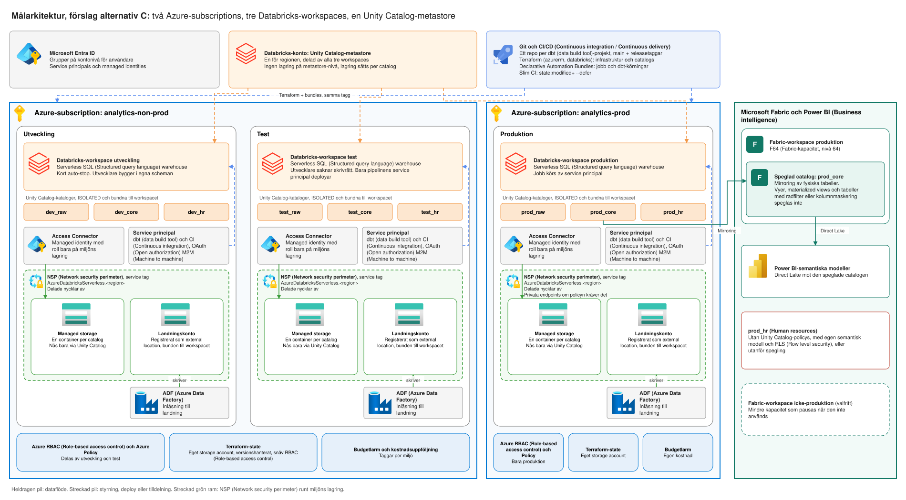

# Målarkitektur: Azure, Databricks och dbt (data build tool)

2026-10-10 · Peter

## Om dokumentet

Det här dokumentet är ett förslag till målarkitektur för en dataplattform på Azure med Databricks, dbt (data build tool) Core och Fabric. Det är skrivet som underlag för ledningens ställningstagande. Ingenting i det är beslutat, och förslaget gäller först när ledningen har godkänt det.

Dokumentet jämför fyra sätt att dela upp subscriptions och workspaces, föreslår ett av dem och beskriver hur isolering, promotion i dbt (data build tool), Terraform, Fabric och kostnad fungerar i det upplägget. Varje påstående är märkt med hur säkert det är: Dokumenterat betyder att det följer av leverantörens dokumentation, Rekommendation att dokumentationen rekommenderar det, och Bedömning att det är författarens slutsats. Förkortningar och begrepp förklaras i bilagan för den som inte är tekniker.

### Alternativ som övervägdes

Alla fyra har tre Databricks-workspaces eller färre, en Unity Catalog-metastore för regionen och samma dbt (data build tool)-kod i alla miljöer. De skiljer sig i hur många Azure-subscriptions miljöerna fördelas på. En subscription är den gräns i Azure där behörighet, policy, kostnad och kvoter sätts.

- **A. Ett workspace:** en subscription, ett workspace och en catalog per miljö. Isoleringen består av grants på catalogs, så ett felaktigt grant ger utveckling åtkomst till produktion. Dokumentationen kräver dessutom att produktion är ett annat workspace än utveckling, vilket gör alternativet svårt att försvara för produktionsdata.
- **B. En subscription:** tre workspaces (utveckling, test, produktion) och separat lagring per miljö, allt i en subscription. Bindning av catalogs, credentials och external locations håller miljöerna isär i Databricks, men Azure RBAC (Role-based access control), policy, kostnadsuppföljning och kvoter delas av alla miljöer. Den som har Contributor på subscriptionen når allt.
- **C. Två subscriptions:** en för icke-produktion (utveckling och test) och en för produktion, med tre workspaces och separat lagring per miljö. Som B, plus att produktion får egen RBAC (Role-based access control), policy och kostnadsuppföljning. Utveckling och test delar fortfarande RBAC (Role-based access control) och kvoter.
- **D. Tre subscriptions:** en per miljö plus en delad plattformssubscription för hubnät, DNS (Domain name system), Terraform-state och build-agenter. Som C, plus att test får egen RBAC (Role-based access control) och policy. Det blir flest delar att hålla i synk, och varje extra nätverk med privata endpoints kostar löpande.

Två varianter prövades också och avfärdades: ett workspace per team, som Databricks avråder från, och fler workspaces per miljö, som bara motiveras av en annan region, ett regelverk eller en affärsenhet med krav på total isolering.

### Varför alternativ C föreslås

Alternativ C är det minsta upplägg där produktion har en gräns som inte går att ändra inifrån Databricks. I A och B ligger alla miljöer i samma subscription, så en felsatt behörighet eller ett felsatt grant kan ge åtkomst till produktion. I C har produktion egen RBAC (Role-based access control), policy och kostnadsuppföljning, och ingen i ett utvecklingsworkspace kan ändra dem.

Skillnaden mot D är att test får egen RBAC (Role-based access control) och policy. Det kräver en delad plattformssubscription och ett extra nätverk, och behövs inte så länge utvecklare saknar skrivrättigheter på test och bara pipelinens service principal deployar dit. Förslaget ändras till D om test måste ha samma nätverkspolicy som produktion, om olika team ska äga utveckling och test, eller om en revisor kräver att test inte delar RBAC (Role-based access control) med utveckling. Det ändras till B om teamet och volymen är så små att en andra subscription kostar mer i hantering än den ger i skydd.

Valet av C bygger på två delar. Tre workspaces (utveckling, test och produktion) och automatisering med Terraform följer Databricks och Microsofts rekommendationer: SDLC (Software development life cycle)-miljöer delas upp i separata workspaces, produktion är ett eget workspace, och uppsättning och underhåll av flera workspaces ska vara fullt automatiserade. Uppdelningen i två subscriptions är en bedömning. Dokumentationen rekommenderar varken en eller flera subscriptions per miljö. Microsofts vägledning för Azure landing zones beskriver subscriptionen som en gräns för policy och förvaltning och varnar för en stel subscriptionsmodell, men föreskriver ingen uppdelning. Alternativ B (en subscription, tre workspaces) följer rekommendationerna fullt ut. C väljs för att produktion då får en gräns i Azure som ingen i ett utvecklingsworkspace kan ändra.

## Sammanfattning

**Förslag (alternativ C):** Två subscriptions (icke-produktion och produktion), tre Databricks-workspaces (utveckling, test, produktion) och en Unity Catalog-metastore per region. Isoleringen sker i katalogerna `{miljö}_raw`, `{miljö}_core` och `{miljö}_hr`. Varje katalog binds ISOLATED till sin miljös workspace och ligger på eget storage-konto bakom en egen Access Connector.

- **Infrastruktur** hanteras med Terraform (azurerm och databricks), **jobb och dbt (data build tool)-körningar** med Declarative Automation Bundles.
- **dbt (data build tool) Core** promoveras utveckling → test → produktion genom samma kod och olika targets. Slim CI (Continuous integration) använder `state:modified+ --defer`, och produktion körs av en service principal med OAuth (Open authorization) M2M (Machine to machine).
- **Fabric** speglar produktion via mirroring och Power BI (Business intelligence) läser med Direct Lake. Vyer och tabeller med radfilter eller kolumnmaskering speglas inte och behöver en annan väg.
- **Serverless SQL (Structured query language)** mot ett låst storage-konto kräver NSP (Network security perimeter) och service tag `AzureDatabricksServerless.<region>`. Allowlisting av subnät fungerar inte för serverless.

**Risker med enklare alternativ.** En enda subscription ger gemensam gräns för RBAC (Role-based access control) och policy, så en felaktig rolltilldelning når produktion. Tre subscriptions ger starkast separation men tredubblar landing-zone-arbetet. Kriterier för att gå från C till B (en subscription) eller D (tre subscriptions) finns i avsnittet om arkitekturalternativ.


## Grundläggande designbeslut

Metastoren isolerar ingenting mellan miljöerna. Isoleringen byggs av fyra andra beslut: subscription (behörighet, policy, kostnad, kvoter), workspace (compute, nätverk, inställningar), catalog (dataåtkomst) och storage (fysisk lagring).

| Beslut | Vad det avgränsar | Vad dokumentationen säger |
| --- | --- | --- |
| Azure subscription | Azure RBAC (Role-based access control), policy, kostnad och tjänstekvoter | Workspaces med höga resurskrav bör ligga i separata subscriptions för att komma runt subscription-gränser ([workspace strategy](https://learn.microsoft.com/en-in/Azure/databricks/lakehouse-architecture/deployment-guide/workspace-strategy)) |
| Workspace | Compute, nätverk, workspace-inställningar och funktioner som Private Link och kryptering | Dela upp SDLC (Software development life cycle) i separata workspaces, minst utveckling och produktion. Skapa inte workspaces per team eller litet projekt. Över 50 till 100 workspaces kräver stark motivering och automatisering ([workspace strategy](https://learn.microsoft.com/en-in/Azure/databricks/lakehouse-architecture/deployment-guide/workspace-strategy)) |
| Metastore | Regional namnrymd för Unity Catalog | En per region, delad av alla workspaces i regionen. Den är inte avsedd som standardenhet för dataisolering ([Unity Catalog best practices](https://learn.microsoft.com/en-us/azure/databricks/data-governance/unity-catalog/best-practices)) |
| Catalog | Dataåtkomst, den primära isoleringsenheten | Katalogen kan bindas till utvalda workspaces. Databricks rekommenderar lagring på catalog-nivå som primär enhet för dataisolering ([best practices](https://learn.microsoft.com/en-us/azure/databricks/data-governance/unity-catalog/best-practices)) |
| Storage account och container | Fysisk lagring och I/O (Input/output)-kapacitet | ADLS (Azure Data Lake Storage)-konton har som standard 20 000 förfrågningar per sekund. Managed storage ska ligga i en container som inte nås utanför Unity Catalog ([best practices](https://learn.microsoft.com/en-us/azure/databricks/data-governance/unity-catalog/best-practices)) |
| Access Connector och storage credential | Vilken identitet Unity Catalog använder mot lagringen | Managed identity rekommenderas framför service principal, eftersom den saknar hemligheter att rotera och fungerar med lagringens brandvägg ([create metastore](https://learn.microsoft.com/en-us/azure/databricks/data-governance/unity-catalog/create-metastore)) |
| Nätverk | Vilka vägar trafiken får ta | Private Link och krypteringsnycklar sätts per workspace ([workspace strategy](https://learn.microsoft.com/en-in/Azure/databricks/lakehouse-architecture/deployment-guide/workspace-strategy)) |

### Så påverkar besluten varandra

1. **Metastoren och miljöerna:** Ligger utveckling, test och produktion i samma region delar de en metastore, och dokumentationen rekommenderar just det. Gränsen mellan miljöerna dras då med catalog-bindningar. Dokumenterat.
2. **Bindningen kräver separata workspaces:** En bunden catalog (isolation mode ISOLATED) nekar åtkomst från obundna workspaces, även för användare med SELECT. Är utveckling och produktion samma workspace går det inte att binda dem isär. Dokumenterat ([binding](https://learn.microsoft.com/en-us/azure/databricks/catalogs/binding)).
3. **Storage credentials måste bindas:** Bindning gäller även storage credentials och external locations. Delar alla miljöer en credential som är öppen för alla workspaces kan utveckling nå produktionslagringen på filsökväg, trots separata catalogs. Dokumenterat, slutsatsen är en bedömning.
4. **Subscription-gränsen är den enda som ligger utanför Databricks:** Azure RBAC (Role-based access control) och Azure Policy på en separat produktionssubscription kan inte ändras från ett Databricks-workspace i utveckling. Bedömning.
5. **Flera workspaces kräver automatisering:** Dokumentationen säger att uppsättning och underhåll av flera workspaces ska vara fullt automatiserade. Det knyter beslutet om antal workspaces till valet av Terraform. Dokumenterat.

## Arkitekturalternativ

Alternativ A (ett workspace) går inte att försvara för produktionsdata. Alternativ C (två subscriptions) är det minsta som ger en isolering utanför Databricks. Bedömningen av alternativen bygger på de dokumenterade reglerna från föregående avsnitt.

| Alternativ | Uppbyggnad | Vad isoleringen består av | Främsta risk | Kostnad och komplexitet |
| --- | --- | --- | --- | --- |
| **A. Ett workspace** | 1 subscription, 1 workspace, catalogs per miljö, 1 storage account | Bara grants på catalogs | Ett felaktigt grant ger utveckling åtkomst till produktion. Workspace-inställningar går inte att testa före produktion, eftersom dokumentationen kräver att produktion är ett annat workspace än utveckling eller staging för det | Lägst |
| **B. En subscription** | 1 subscription, 3 workspaces, 1 storage account per miljö | Catalog-, credential- och external location-bindning per workspace, fysiskt separat lagring | Azure RBAC (Role-based access control), policy, kostnadsuppföljning och kvoter delas av alla miljöer. Den som har Contributor på subscriptionen når allt | Låg. Tre workspaces, tre storage accounts, tre Access Connectors |
| **C. Två subscriptions** | 2 subscriptions (icke-produktion med utveckling och test, samt produktion), 3 workspaces, 1 storage account per miljö | Som B, plus att produktion har egen RBAC (Role-based access control), policy och kostnad | Utveckling och test delar RBAC (Role-based access control) och kvoter. Ett test som utvecklare kan ändra manuellt är en svag grind | Medel. Egen nätverksuppsättning för produktion, och automatisering är ett krav |
| **D. Tre subscriptions** | 3 subscriptions (utveckling, test, produktion) plus en delad plattformssubscription för hubnät, DNS (Domain name system), Terraform-state och build-agenter | Som C, plus att test har egen RBAC (Role-based access control) och policy | Flest delar att hålla i synk. Varje extra nätverk med privata endpoints kostar löpande, och dokumentationen varnar för att nätverksinfrastruktur blir dyr med många workspaces | Högst |

### Det som är lika i B, C och D

- En metastore i regionen, delad av alla workspaces. Dokumenterat.
- Ett workspace per miljö och inget per team. Dokumenterat, eftersom team separeras med catalogs och schemas.
- Samma dbt (data build tool)-kod i alla miljöer, där bara målets catalog och anslutning skiljer.
- Alla miljöer skapas med Terraform. Dokumenterat för flera workspaces.

### Det som skiljer

Skillnaden mellan B, C och D är vem som kan ändra vad. B litar på att behörigheterna i en subscription är rätt satta. C och D lägger gränsen i Azure, där den inte går att ändra från Databricks.

### Övervägda varianter utanför tabellen

- **Ett workspace per team:** Databricks avråder från workspaces per team eller litet projekt. Team separeras med catalogs och scheman i stället. Dokumenterat.
- **Fler workspaces per miljö:** Motiveras bara av en annan region, ett regelverk eller en affärsenhet med krav på total isolering. Dokumenterat och bedömning.

## Föreslagen målarkitektur

Förslag: alternativ C: två subscriptions (icke-produktion och produktion), tre workspaces, en metastore och en uppsättning lagring per miljö. Det är det minsta upplägg där produktion har en gräns som inte går att ändra inifrån Databricks. Kolumnen Typ visar om beslutet följer av dokumentationen, är en rekommendation i den eller bygger på en bedömning.

| Beslut | Rekommendation | Typ | Motivering |
| --- | --- | --- | --- |
| Subscriptions | Två: icke-produktion (utveckling och test) och produktion | Bedömning | Produktion får egen RBAC (Role-based access control), policy och kostnadsuppföljning. Utveckling och test skyddas genom att utvecklare saknar skrivrättigheter på test, där bara pipelinens service principal deployar |
| Workspaces | Tre: utveckling, test och produktion, i samma region som lagringen | Dokumenterat | Dokumentationen rekommenderar separata workspaces för SDLC (Software development life cycle)-miljöer och menar att produktion måste vara ett eget workspace för att inställningar ska kunna testas först |
| Metastore | En för regionen, utan metastore-nivålagring | Dokumenterat | Metastore-lagring är valfri och inte längre ett krav. Lagring läggs på catalog-nivå |
| Catalogs | Per miljö: `{miljö}_raw`, `{miljö}_core` och `{miljö}_hr` | Bedömning | Raw skrivs av inläsningen, core av dbt (data build tool) och HR (Human resources) har egen åtkomstkrets. Catalog är isoleringsenheten, så uppdelningen följer vem som får läsa |
| Bindning | Alla catalogs ISOLATED och bundna till sin miljös workspace. Storage credentials och external locations bundna på samma sätt | Dokumenterat | Obundna workspaces nekas åtkomst, även för användare med SELECT. Credentials och locations går att binda |
| Lagring | Per miljö ett konto för managed storage (en container per catalog) och ett för landning där ADF (Azure Data Factory) skriver | Rekommendation | Managed storage ska ligga i en container som inte nås utanför Unity Catalog, och ADF (Azure Data Factory) är en sådan åtkomst. Landningskontot registreras som external location |
| Identiteter | En Access Connector per miljö med roll bara på den miljöns lagring. En service principal per miljö för dbt (data build tool) och CI (Continuous integration) med OAuth (Open authorization) M2M (Machine to machine) | Rekommendation | Managed identity och OAuth (Open authorization) M2M (Machine to machine) är de rekommenderade alternativen i dokumentationen |
| Användare | Entra-grupper på kontonivå, inte workspace-grupper | Dokumenterat | Gruppen workspace admins är lokal till sitt workspace och går inte att använda över flera |
| Nätverk | Serverless mot lagringen via service endpoints och network security perimeter med taggen AzureDatabricksServerless. Privata endpoints i produktion om policyn kräver det | Dokumenterat och bedömning | Se avsnittet om isolering |
| Konsumtion | Fabric speglar produktionscatalogen, Power BI (Business intelligence) läser med Direct Lake | Dokumenterat | Se avsnittet om Fabric |

### När rekommendationen ska ändras

- **Till tre subscriptions (alternativ D):** Om test måste ha samma nätverkspolicy som produktion, om olika team ska ha olika ägare av utveckling och test, eller om en revisor kräver att test inte delar RBAC (Role-based access control) med utveckling.
- **Till färre (alternativ B):** Om volymen och teamet är så små att en andra subscription kostar mer i hantering än den ger i skydd. Risken är då att alla miljöer delar Azure RBAC (Role-based access control) och kvoter.
- **Till fler workspaces:** Bara när en annan region, ett regelverk eller en affärsenhet med krav på total isolering kräver det. Dokumentationen avråder från workspaces per team.

## Arkitekturdiagram



Redigerbar källa: [`malarkitektur-alternativ-c.drawio`](malarkitektur-alternativ-c.drawio).

Varje miljö har eget workspace, egna catalogs och egen lagring med en egen Access Connector. Pipelinen deployar samma tagg genom miljöerna, och bara produktionscatalogen speglas till Fabric.

## Isolering och säkerhet

Miljöerna isoleras i fyra lager som stoppar olika saker, och inget lager ersätter ett annat. Serverless-compute kräver dessutom en annan brandväggskonfiguration än den som beskrevs i många äldre guider.

| Lager | Kontroll | Vad den stoppar |
| --- | --- | --- |
| Azure | Separat produktionssubscription, Azure Policy, RBAC (Role-based access control) på resursgrupp | Ändringar av produktionsresurser från utvecklingssidan, felkonfigurerade lagringskonton |
| Databricks | ISOLATED-catalogs och bundna credentials och external locations | Åtkomst till produktionsdata från utvecklings- och test-workspaces, även med SELECT |
| Identitet | Access Connector och service principal per miljö | En stulen eller felanvänd identitet i utveckling når produktion |
| Nätverk | Lagringsbrandvägg, network security perimeter, privata endpoints där policyn kräver det | Åtkomst från obehöriga nät |

### Grundskydd på varje lagringskonto

- **Anonym åtkomst av:** Sätt `AllowBlobPublicAccess` till false på kontot. Inställningen på kontot går före containerns egen, så publika containrar slutar svara utan att varje container ändras. Dokumenterat ([Microsoft Learn](https://learn.microsoft.com/en-us/azure/storage/blobs/anonymous-read-access-prevent)).
- **Policy som nekar:** Azure Policy med effekten deny blockerar nya konton med anonym åtkomst och ändringar av befintliga. Kör en Resource Graph-fråga över alla subscriptions för att hitta konton som redan avviker. Dokumenterat.
- **Spåra anonyma anrop:** Metrikfilter på Authentication = Anonymous eller en logganalysfråga mot `StorageBlobLogs` visar om något redan läser anonymt. Dokumenterat.
- **Delade nycklar av:** Stäng åtkomst med kontonycklar så att bara Entra-identiteter fungerar. Bedömning, verifiera mot Microsofts dokumentation för storage-konton.

### Access Connector och lagringsbrandvägg

- Ge connectorn rollen Storage Blob Data Contributor på den miljöns konto. Det smalare alternativet är Storage Blob Delegator på kontot plus Data Contributor på en enskild container. Dokumenterat ([Microsoft Learn](https://learn.microsoft.com/en-us/azure/databricks/connect/unity-catalog/cloud-storage/azure-managed-identities)).
- Slå av "Allow Azure services on the trusted services list" och lägg en resource instance rule för just den connectorn. Är inställningen på kan vilken Access Connector som helst i tenanten nå kontot. Dokumenterat.

### Serverless och lagringsbrandväggen

Storage-konton som släpper in serverless-compute via subnet-ID (Identifier) får numera 403. Ersättningen är en NSP (Network security perimeter) med en inkommande regel för service taggen `AzureDatabricksServerless.<region>`. Dokumenterat ([Microsoft Learn](https://learn.microsoft.com/en-us/azure/databricks/security/network/serverless-network-security/serverless-firewall-config)).

- Behåll transition mode, som är förvalet och det Databricks rekommenderar för de flesta.
- Lämna "Public network access" på "Enabled from selected networks". Värdet "Secured by Perimeter" ger PERMISSION_DENIED för serverless.
- Slå på diagnostikinställningar på själva NSP (Network security perimeter). Lagringskontots egna loggar visar inte NSP (Network security perimeter)-reglerna.
- Trafik över service endpoints debiteras inte för databehandling. Dokumenterat.

### Bindning

Tre bindningar per miljö: catalogs, storage credentials och external locations. Kommandona kommer från Databricks dokumentation ([binding](https://learn.microsoft.com/en-us/azure/databricks/catalogs/binding)).

```bash
databricks catalogs update prod_core --isolation-mode ISOLATED
databricks workspace-bindings update-bindings catalog prod_core \
  --json '{"add": [{"workspace_id": <prod-workspace-id>}], "remove": []}'
```

### Så verifierar ni isoleringen

1. Kör `SELECT` mot en produktionstabell från utvecklingsworkspacet. Förväntat resultat: nekad.
2. Kör `LIST 'abfss://<container>@<konto>.dfs.core.windows.net/'` mot produktionslagringen från utveckling. Förväntat resultat: nekad.
3. Kör samma `LIST` från produktion mot en serverless warehouse. Förväntat resultat: lyckas, vilket bekräftar att NSP (Network security perimeter)-regeln fungerar. Dokumenterat som verifieringssteg.
4. Försök skapa ett lagringskonto med anonym åtkomst i produktionssubscriptionen. Förväntat resultat: Azure Policy nekar.

### Privata endpoints

Dokumentationen säger att Private Link och krypteringsnycklar sätts per workspace, och att nätverksinfrastruktur blir dyr när många workspaces ska skyddas på nätverksnivå. Bedömningen är att produktion ska ha privata endpoints när bolagets säkerhetspolicy kräver det, och att utveckling och test kan nöja sig med brandvägg och NSP (Network security perimeter). Det lämnar en skillnad mellan test och produktion i nätverk som ni behöver acceptera medvetet och dokumentera.

## dbt (data build tool) Core, Git och CI/CD (Continuous integration / continuous delivery)

Samma commit ska gå genom utveckling, test och produktion, och det enda som får skilja mellan miljöerna är konfiguration: målets catalog, anslutning och identitet. Ändras modellkoden mellan miljöerna testar ni inte det som går till produktion.

### Grundregler

- **Adapter:** `dbt-databricks` mot ett SQL (Structured query language) warehouse. Anslutningen anges med host och http_path. Dokumenterat ([Microsoft Learn](https://learn.microsoft.com/en-us/azure/databricks/partners/prep/dbt)).
- **Autentisering:** OAuth (Open authorization) M2M (Machine to machine) med en service principal per miljö. Klient-id (identifier) och hemlighet läggs i miljövariabler, aldrig i `profiles.yml`. Dokumenterat.
- **Targets:** Ett target per miljö i `profiles.yml`, där `catalog` styr vilken miljös catalog dbt (data build tool) bygger i. Modellerna refererar aldrig en catalog med namn. Rekommendation.
- **Git:** Ett repo per dbt (data build tool)-projekt, `main` som enda långlivade gren och releaser som taggar. Miljöerna väljer tagg, inte gren. Rekommendation.

### Flödet från kod till produktion

1. **Pull request:** Pipelinen kör `dbt build --select state:modified+ --defer --state <prod-artefakter>` mot ett CI (Continuous integration)-schema i utvecklingscatalogen. Då byggs bara ändrade modeller och deras nedströms, och oförändrade uppströms modeller läses från produktionsartefakternas objekt. Dokumenterat i dbt (data build tool)-dokumentationen, med varningen att utvecklings- och produktionsdata då blandas.
2. **Merge till main:** Pipelinen taggar en release och deployar till test-workspacet med test-miljöns service principal. Hela projektet körs, inte bara de ändrade modellerna.
3. **Test:** Dbt (data build tool)-tester och en avstämning av radantal och summor mot föregående produktionskörning körs på test-catalogen. Passerar de godkänner en person eller en regel promotionen.
4. **Produktion:** Samma tagg deployas till produktionsworkspacet med produktionsmiljöns service principal. Produktionskörningens `manifest.json` sparas som artefakt och blir `--state` för nästa pull request.

### Varför defer behöver en reservation

Dokumentationen varnar för att defer kan blanda objekt från olika miljöer, och att en gammal eller ofullständig utvecklingstabell skuggar produktionsfallbacken. Rensa CI (Continuous integration)-schemat efter varje körning och läs inte produktionsdata i utveckling om produktion innehåller personuppgifter. Då ska CI (Continuous integration) läsa test-catalogens data i stället, och `--state` pekar på test-körningens artefakter. Bedömning.

### Körning i plattformen

Dbt (data build tool) Core-projekt kan köras som jobbtasks i Lakeflow Jobs. Dokumenterat ([Microsoft Learn](https://learn.microsoft.com/en-us/azure/databricks/partners/prep/dbt)). Bundle-mallen `dbt-sql` innehåller ett jobb med en dbt (data build tool)-task och en profilfil för deployade dbt (data build tool)-jobb ([Microsoft Learn](https://learn.microsoft.com/en-us/azure/databricks/dev-tools/bundles/templates)). Sidan om dbt (data build tool)-tasken i jobb gick inte att hämta, så detaljer om källa, compute och profilhantering behöver bekräftas mot den.

| Fråga | Alternativ | Bedömning |
| --- | --- | --- |
| Vem schemalägger? | Lakeflow Jobs eller Azure Data Factory som startar jobbet | Låt ADF (Azure Data Factory) starta Databricks-jobbet efter inläsningen om ADF (Azure Data Factory) ändå äger inläsningen. Då finns en kedja och ett ställe att felsöka |
| Vilken compute? | Serverless SQL (Structured query language) warehouse | Det passar SQL (Structured query language)-modeller och startar snabbt. Python-modeller kräver annan compute |
| Var ligger dbt (data build tool)-koden vid körning? | Git-källa eller workspace-filer | Git-källa med taggen som referens, så att körningen är spårbar till en release |

## Terraform och Declarative Automation Bundles

Terraform äger infrastrukturen och Unity Catalog-strukturen. Bundles äger det som körs ovanpå, alltså jobb, pipelines och dbt (data build tool)-körningar. Gränsen är en bedömning. Dokumentationen kräver bara att flera workspaces sätts upp och underhålls fullt automatiserat.

| Lager | Verktyg | Innehåll | Distribueras av |
| --- | --- | --- | --- |
| Azure | Terraform (azurerm) | Resursgrupper, nätverk, storage accounts, Access Connectors, NSP (Network security perimeter), policy-tilldelningar | Plattformsteamet, via pipeline med godkännande |
| Databricks-plattform | Terraform (databricks) | Workspaces, metastore-koppling, catalogs, storage credentials, external locations, bindningar, grants, service principals | Plattformsteamet, i samma pipeline som Azure-lagret |
| Körning | Bundles | Jobb, pipelines och dbt (data build tool)-tasks per target (utveckling, test, produktion) | Utvecklingsteamet, från dbt (data build tool)-repot |
| Modellkod | Git och dbt (data build tool) | SQL (Structured query language)-modeller, tester, `profiles.yml` | Utvecklingsteamet |

### Varför catalogs och bindningar ligger i Terraform

Catalogs, storage credentials och external locations beror på lagringskonton och Access Connectors som Terraform redan skapar, och de behöver skapas i en bestämd ordning. Bindningarna kräver att catalogens isolation mode redan är ISOLATED. Sätter Terraform läget skapas bindningen automatiskt till det workspace som skapade den. Dokumenterat ([provider-dokumentation](https://github.com/databricks/terraform-provider-databricks/blob/main/docs/resources/workspace_binding.md)). Binding-resursen stödjer catalogs, external locations, storage credentials och credentials, och READ_ONLY gäller bara catalogs.

Bundles kan också hantera catalogs och external locations med den direkta deploymotorn, så ett team som vill ha allt i en verktygskedja kan välja det. Terraform är att föredra eftersom Azure-resurserna och Unity Catalog-objekten då hänger ihop i en plan med ett state.

### Bundles: motor och targets

- **Deploymotor:** Bundles som skapats med CLI (Command line interface) 1.3.0 eller senare använder den direkta motorn som standard, och Databricks skriver att Terraform-motorn snart stängs av. Då behöver inte bundle-pipelinen Terraform installerat. Dokumenterat ([Databricks docs](https://docs.databricks.com/gcp/en/dev-tools/bundles/direct)).
- **Targets:** Ett target per miljö i `databricks.yml`, med eget `workspace.host` och egna variabler, till exempel catalog och warehouse. Ett target ändrar bara det som det anger. Dokumenterat ([Microsoft Learn](https://learn.microsoft.com/en-us/azure/databricks/dev-tools/bundles/settings)).
- **Identitet:** `run_as` kan ange en service principal. Sidan visar inget exempel per target, så testa att test- och produktionsjobben körs som respektive miljös service principal.

### Pipeline

1. **Pull request:** `terraform plan` för infrastrukturrepot, och `databricks bundle validate` samt `bundle plan` för dbt (data build tool)-repot.
2. **Merge:** Apply till utveckling och test automatiskt. Produktion kräver godkännande av en person som inte skrev ändringen.
3. **Identiteter:** Terraform-pipelinens service principal i produktion har Contributor på produktionsresursgrupperna och inget annat. Samma mönster i icke-produktion. Rekommendation.
4. **State:** Terraform-state i ett eget storage account per subscription med versionshantering och snäv RBAC (Role-based access control). Bundles lagrar sitt state i workspacet. Rekommendation.
5. **Drift:** Kör `terraform plan` schemalagt och larma på avvikelser. Manuella ändringar i portalen är den vanligaste orsaken till att miljöerna glider isär. Bedömning.

## Fabric och Power BI (Business intelligence)

Fabric speglar produktionscatalogen och Power BI (Business intelligence) läser med Direct Lake. Två begränsningar styr designen: tabeller med radfilter eller kolumnmaskering i Unity Catalog kan inte speglas, och Unity Catalogs behörigheter följer inte med till Fabric.

### Så fungerar spegling

Spegling för Azure Databricks speglar bara catalogens struktur. Data nås genom genvägar utan kopiering, och ändringar kan ta från några sekunder till några minuter att visas. Direct Lake går att använda mot det speglade objektet. Dokumenterat ([Microsoft Learn](https://learn.microsoft.com/en-us/fabric/mirroring/azure-databricks)). Sweden Central finns på listan över stödda regioner ([begränsningar](https://learn.microsoft.com/en-us/fabric/mirroring/azure-databricks-limitations)). Sidan anger inte om funktionen är i preview eller generellt tillgänglig, så kontrollera status mot Fabrics releaseinformation.

### Det som inte speglas

Vyer, materialized views, streaming tables, tabeller med radfilter eller kolumnmaskering, federerade tabeller och Delta sharing-tabeller stöds inte. Dokumenterat ([begränsningar](https://learn.microsoft.com/en-us/fabric/mirroring/azure-databricks-limitations)). Det som Power BI (Business intelligence) ska läsa måste därför vara fysiska tabeller i `{miljö}_core`, så dbt (data build tool)-modellerna i marts-lagret materialiseras som `table` eller `incremental`. Slutsats.

### Behörighet

- **Unity Catalogs behörigheter speglas inte.** De måste byggas om med Fabrics behörighetsmodell och workspace-roller. Dokumenterat ([säkerhet](https://learn.microsoft.com/en-us/fabric/mirroring/azure-databricks-security)).
- **Spegelanslutningen använder en identitet för alla frågor,** en service principal eller OAuth (Open authorization). Alla användare får alltså se det den identiteten ser, och uppdelningen per bolag och anläggning måste ligga som RLS (Row level security) i semantic model. Dokumenterat, slutsatsen är egen.
- **HR (Human resources)-data:** Unity Catalogs radfilter och kolumnmaskering gäller inte vid direkt lagringsåtkomst, och tabeller med sådana policys speglas inte alls. Lägg `{miljö}_hr` utan Unity Catalog-policys, med en egen semantic model och RLS (Row level security), eller lämna den utanför spegling. Dokumenterat och bedömning.

### Nätverk

För ett brandväggsskyddat ADLS (Azure Data Lake Storage) Gen2 (Generation 2) krävs trusted workspace access, en separat anslutning direkt mot lagringskontot och att Fabrics Workspace Identity släpps in i kontots brandvägg. Dokumenterat ([säkerhet](https://learn.microsoft.com/en-us/fabric/mirroring/azure-databricks-security)). Det kommer utöver NSP (Network security perimeter)-regeln för serverless i föregående avsnitt.

### Kapacitet och Direct Lake

Direct Lake kräver en Fabric-kapacitet av F-typ (Fabric-kapacitetsnivå). Vid F64 (Fabric-kapacitet, nivå 64) gäller dessa gränser ([Direct Lake](https://learn.microsoft.com/en-us/fabric/fundamentals/direct-lake-overview)):

| Gräns | F64 (Fabric-kapacitet, nivå 64) |
| --- | --- |
| Parquet-filer per tabell | 5 000 |
| Row groups per tabell | 5 000 |
| Rader per tabell | 1 500 miljoner |
| Max minne per fråga (mjuk övre gräns) | 25 GB (Gigabyte) |

Överskrids gränserna misslyckas uppdateringen av en Direct Lake-modell på OneLake, och modellen går inte att fråga förrän Delta-tabellerna optimerats. Direct Lake på SQL (Structured query language)-endpoint faller i stället tillbaka till DirectQuery, som är långsammare. Dokumenterat. Kör OPTIMIZE på gold-tabellerna så att antalet filer hålls nere, och mät förbrukningen med Capacity Metrics-appen under testet. Rekommendation.

### Miljöer och licens

- **Fabric-workspaces:** Ett per miljö, där varje speglar sin miljös catalog. Produktion ligger på F64 (Fabric-kapacitet, nivå 64). Icke-produktion kan ligga på en mindre kapacitet som pausas när den inte används. Bedömning.
- **Läsarlicens:** Vid F64 (Fabric-kapacitet, nivå 64) behöver läsare normalt inte Power BI (Business intelligence) Pro, medan den som skapar innehåll gör det. Licensvillkoren är inte verifierade i den här utredningen och behöver bekräftas mot Microsofts aktuella licensguide innan något utlovas.

## Kostnad och operativ komplexitet

De flesta kostnaderna följer användningen, så de stora kostnadsdrivarna är compute under körning, privata endpoints som debiteras per timme och datatrafik mellan regioner. Antalet subscriptions och workspaces kostar i sig nästan ingenting. Det de kostar är tid för automatisering och granskning. Inga kronbelopp anges, eftersom de prissidor som lästes inte visade DBU (Databricks unit)-priset.

### Vad som kostar

| Post | Typ av kostnad | Vad dokumentationen säger |
| --- | --- | --- |
| Serverless SQL (Structured query language) warehouse | Per DBU (Databricks unit)-timme medan det kör | DBU (Databricks unit) per timme per storlek står på [Azures prissida](https://azure.microsoft.com/en-us/pricing/details/databricks/). Serverless inkluderar compute, men datatrafik, NAT (Network address translation) och privata endpoints debiteras extra |
| Privata endpoints | Per timme, så länge de finns | Per-GB (Gigabyte)-avgiften är undantagen tills vidare. Timavgiften debiteras av Azure ([kostnadshantering](https://learn.microsoft.com/en-us/azure/databricks/security/network/serverless-network-security/cost-management)) |
| Service endpoints med NSP (Network security perimeter) | Ingen avgift | Gäller trafik i samma region. Sedan 7 april 2026 kräver service endpoints en NSP (Network security perimeter). Trafik mellan regioner debiteras |
| NAT (Network address translation) gateway | Per timme och per GB (Gigabyte) | Debiteras av Azure när serverless når resurser över publikt nät |
| Fabric-kapacitet | Fast per kapacitet | F64 (Fabric-kapacitet, nivå 64) finns redan. Spegling och Direct Lake drar kapacitetsenheter, och förbrukningen mäts med Capacity Metrics |
| Lagring | Per GB (Gigabyte) och månad plus transaktioner | Hålls nere genom att ligga i samma region och optimera filstorlekar |

### Vad som är komplexitet

Förslaget (alternativ C) ger ungefär detta att hantera. Antalen är en uppskattning.

- 2 subscriptions och 3 workspaces
- 6 storage accounts: ett för managed storage och ett för landning per miljö
- 3 Access Connectors, en per miljö
- Ungefär 8 service principals: dbt (data build tool) per miljö, Terraform per subscription och CI (Continuous integration)
- 3 Terraform-state och 3 bundle-targets
- Bindningar för varje catalog, credential och external location

Allt detta är konfiguration som Terraform skapar från en modul som instansieras per miljö. Den löpande komplexiteten ligger i att hålla miljöerna lika, vilket schemalagd `terraform plan` hanterar.

### Vad enklare alternativ riskerar

| Förenkling | Vad det sparar | Risk |
| --- | --- | --- |
| Ett workspace för alla miljöer | Två workspaces och deras bindningar | Catalogs kan inte bindas per miljö, och workspace-inställningar kan inte testas före produktion |
| En subscription | En nätverksuppsättning och en RBAC (Role-based access control)-struktur | Alla miljöer delar RBAC (Role-based access control), policy och kvoter. Den som har Contributor når produktion |
| Ett lagringskonto för alla miljöer | Fem konton | Roll på kontonivå ger åtkomst till alla containers, och miljöerna delar I/O (Input/output)-gränsen på 20 000 förfrågningar per sekund |
| Inga privata endpoints | Timavgiften per endpoint | Skyddet vilar på identitet och brandvägg. Det räcker bara om säkerhetspolicyn tillåter det |
| Ingen schemalagd driftkontroll | Pipeline-tid | Miljöerna glider isär genom manuella ändringar |

### Så följer ni kostnaden

Tagga warehouses och jobb per miljö och använd system-tabellen för debiterad användning. Sätt budgetlarm per subscription. Kör utvecklingswarehouset med kort auto-stop och test-warehouset bara i samband med deployer. Bedömning.

## Källor

Sidorna nedan öppnades och lästes den 10 oktober 2026. Dokumentationen ändras, så kontrollera datum och status på de funktioner som beslut hänger på.

**Databricks och Unity Catalog**

- [Unity Catalog best practices](https://learn.microsoft.com/en-us/azure/databricks/data-governance/unity-catalog/best-practices)
- [Workspace-catalog binding](https://learn.microsoft.com/en-us/azure/databricks/catalogs/binding)
- [Create a Unity Catalog metastore](https://learn.microsoft.com/en-us/azure/databricks/data-governance/unity-catalog/create-metastore)
- [Phase 2: Design workspace strategy](https://learn.microsoft.com/en-in/Azure/databricks/lakehouse-architecture/deployment-guide/workspace-strategy)
- [Subscription design i Azure landing zones](https://learn.microsoft.com/en-us/azure/cloud-adoption-framework/ready/landing-zone/design-area/resource-org-subscriptions)
- [Storage credentials with an access connector](https://learn.microsoft.com/en-us/azure/databricks/connect/unity-catalog/cloud-storage/azure-managed-identities)
- [Azure Databricks pricing](https://azure.microsoft.com/en-us/pricing/details/databricks/)

**Nätverk och lagring**

- [Serverless network security](https://learn.microsoft.com/en-us/azure/databricks/security/network/serverless-network-security/)
- [Configure a firewall for serverless compute access](https://learn.microsoft.com/en-us/azure/databricks/security/network/serverless-network-security/serverless-firewall-config)
- [Understand Databricks networking costs](https://learn.microsoft.com/en-us/azure/databricks/security/network/serverless-network-security/cost-management)
- [Prevent anonymous read access to blob data](https://learn.microsoft.com/en-us/azure/storage/blobs/anonymous-read-access-prevent)

**dbt (data build tool), bundles och Terraform**

- [dbt (data build tool) Core with Azure Databricks](https://learn.microsoft.com/en-us/azure/databricks/partners/prep/dbt)
- [dbt (data build tool): defer](https://docs.getdbt.com/reference/node-selection/defer)
- [Declarative Automation Bundles](https://learn.microsoft.com/en-us/azure/databricks/dev-tools/bundles/)
- [Bundle configuration: targets](https://learn.microsoft.com/en-us/azure/databricks/dev-tools/bundles/settings)
- [Bundle templates](https://learn.microsoft.com/en-us/azure/databricks/dev-tools/bundles/templates)
- [Direct deployment engine](https://docs.databricks.com/gcp/en/dev-tools/bundles/direct)
- [Terraform: databricks_workspace_binding](https://github.com/databricks/terraform-provider-databricks/blob/main/docs/resources/workspace_binding.md)

**Fabric och Power BI (Business intelligence)**

- [Mirroring Azure Databricks Unity Catalog](https://learn.microsoft.com/en-us/fabric/mirroring/azure-databricks)
- [Begränsningar för spegling](https://learn.microsoft.com/en-us/fabric/mirroring/azure-databricks-limitations)
- [Säkerhet för spegling](https://learn.microsoft.com/en-us/fabric/mirroring/azure-databricks-security)
- [Direct Lake overview](https://learn.microsoft.com/en-us/fabric/fundamentals/direct-lake-overview)

### Det som inte är verifierat

- **Dbt (data build tool)-tasken i Lakeflow Jobs:** Sidan gick inte att hämta. Detaljer om källa, compute och profilhantering för dbt (data build tool)-tasken är obekräftade.
- **Fabric-spegling, status:** Sidan anger inte preview eller generell tillgänglighet.
- **Power BI (Business intelligence)-licens vid F64 (Fabric-kapacitet, nivå 64):** Att läsare inte behöver Pro är förkunskap och inte hämtat i den här utredningen.
- **Delade nycklar av på lagringskonton:** Rekommendationen är en bedömning, utan källa här.
- **Pris per DBU (Databricks unit) och kronbelopp:** Prissidorna visade inte beloppen.
- **Delta-funktioner i Direct Lake:** Sidan nämner inte deletion vectors eller column mapping, så stödet för dem på Databricks-skrivna tabeller är obekräftat.

## Bilaga: Ordlista för icke-tekniska läsare

Bilagan förklarar förkortningarna och de tekniska begreppen i dokumentet på vanlig svenska. Förkortningarna står dessutom utskrivna inom parentes varje gång de förekommer i texten. Miljönamnen utveckling, test och produktion står utskrivna i löpande text. I kodexempel och namn som `prod_core` används kortformerna dev och prod.

### Förkortningar

| Förkortning | Fullt namn | Vad det är |
| --- | --- | --- |
| ADF | Azure Data Factory | Microsofts tjänst som flyttar data mellan system enligt ett schema, till exempel från ett affärssystem in till plattformen. |
| ADLS Gen2 | Azure Data Lake Storage Generation 2 | Lagringstjänsten i Azure där datafilerna ligger. Liknar en mycket stor och säker filserver. |
| BI | Business intelligence | Rapportering och analys av verksamhetsdata. Power BI (Business intelligence) är Microsofts verktyg för det. |
| CD | Continuous delivery | Färdig kod levereras automatiskt vidare till nästa miljö. |
| CI | Continuous integration | Varje ändring byggs och testas automatiskt innan den godkänns. |
| CLI | Command line interface | Ett program som styrs med skrivna kommandon i stället för menyer och knappar. |
| DBU | Databricks unit | Databricks mått på förbrukad beräkningskraft. Fakturan räknas som antal enheter gånger ett pris per timme. |
| dbt | data build tool | Verktyget som bygger och testar våra datamodeller med SQL (Structured query language)-kod som ligger i versionshantering. |
| dev, prod | Development, production | Kortformer för utveckling och produktion i kodexempel och namn. |
| DNS | Domain name system | Internets telefonkatalog som översätter namn till adresser. |
| F64 | Fabric-kapacitet, nivå 64 | En köpt storlek på beräkningskraft i Microsoft Fabric. Siffran anger storleken. |
| GB | Gigabyte | Måttänhet för datamängd. |
| HR | Human resources | Personalfunktionen. Här den catalog som innehåller personaldata och därför har en egen åtkomstkrets. |
| I/O | Input/output | Läsning och skrivning mot lagring. |
| ID | Identifier | Ett unikt kännetecken, till exempel för ett workspace. |
| M2M | Machine to machine | Inloggning mellan program utan att en människa är inblandad. |
| NAT | Network address translation | Nätverkstjänst som låter resurser i ett privat nät nå internet via en gemensam adress. |
| NSP | Network security perimeter | En gemensam brandväggsregel som gäller runt flera Azure-tjänster. |
| OAuth | Open authorization | Standard där ett program får behörighet med en tillfällig nyckel i stället för användarnamn och lösenord. |
| RBAC | Role-based access control | Behörigheter i Azure som tilldelas genom roller, till exempel Contributor. |
| RLS | Row level security | Olika användare ser olika rader i samma tabell, till exempel bara sitt eget bolag. |
| SDLC | Software development life cycle | Vägen en ändring tar från utveckling via test till produktion. |
| SQL | Structured query language | Språket för att ställa frågor till databaser och bygga tabeller. |

### Begrepp

| Begrepp | Vad det är |
| --- | --- |
| Subscription | Azure-prenumeration. Avgränsar behörigheter, regler och kostnad för resurserna i den. |
| Resursgrupp | Mapp i en subscription som samlar resurser som hör ihop. |
| Workspace | Databricks arbetsyta där kod och frågor körs. |
| Metastore | Register över vilka tabeller som finns i Unity Catalog. En per region. |
| Unity Catalog | Databricks styrning av data och behörigheter. |
| Catalog | Översta nivån i Unity Catalog. Här den enhet som håller miljöer och känslig data isär. |
| Storage account, container | Lagringskonto i Azure och en mapp på högsta nivå i det. |
| Access Connector | Azure-resurs som ger Databricks en egen identitet mot lagringen. |
| Managed identity | Identitet som Azure sköter åt en tjänst. Den har inget lösenord som kan läcka. |
| Service principal | Teknisk användare för program, till exempel för dbt (data build tool)-körningar. |
| Storage credential, external location | Databricks-objekt som kopplar en identitet till en sökväg i lagringen. |
| Bindning | Regel som anger vilka workspaces som får se ett objekt. |
| ISOLATED | Läge där en catalog bara går att nå från de workspaces den är bunden till. |
| Serverless | Beräkningskraft som Databricks startar och driver åt oss. Vi betalar för den tid den används. |
| SQL warehouse | Beräkningsresurs som kör SQL (Structured query language)-frågor, bland annat från dbt (data build tool). |
| Service endpoint | Väg inom Azures eget nät mellan en tjänst och lagringen. |
| Private endpoint, Private Link | Privat nätverksadress till en Azure-tjänst. Kostar per timme. |
| Terraform | Verktyg som beskriver infrastruktur som kod och skapar den. |
| Declarative Automation Bundles | Databricks sätt att beskriva jobb och körningar som kod. |
| Fabric | Microsofts samlade dataplattform. |
| Mirroring (spegling) | Fabric visar tabeller från Databricks utan att kopiera datan. |
| Direct Lake | Läge i Power BI (Business intelligence) som läser filerna direkt från lagringen. Snabbt och utan separat import. |
| Semantic model | Datamodellen som Power BI (Business intelligence)-rapporter bygger på, med relationer, mått och behörigheter. |
| Entra | Microsofts tjänst för inloggning och identiteter. |
| Azure Policy | Regler som Azure tillämpar automatiskt, till exempel förbud mot anonym åtkomst. |
| Slim CI, defer | dbt (data build tool) bygger bara det som ändrats och läser resten från den senaste produktionskörningen. |
| Drift | Miljöer som glider isär genom manuella ändringar. |
| Dokumenterat, Rekommendation, Bedömning | Etiketter som visar om ett beslut följer av dokumentationen, är en rekommendation från den eller är författarens bedömning. |

